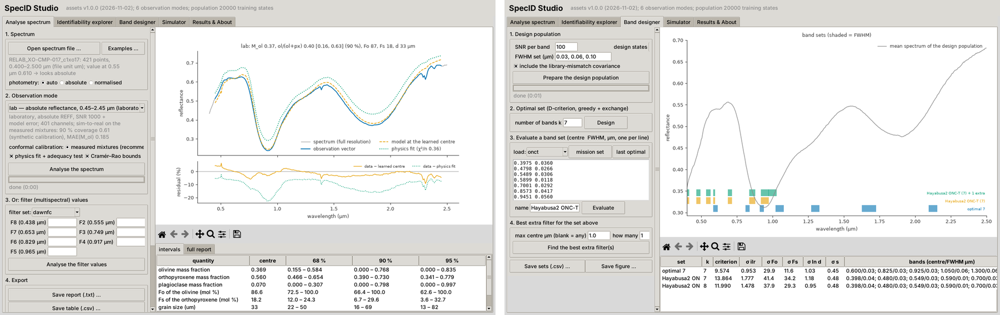

# SpecID — how much mineralogy does a reflectance spectrum hold?

Code, data and desktop application of

> Khairbek, A. A. *How much mineralogy does a reflectance spectrum hold? Information limits, distribution-free uncertainty and
> optimal band selection for olivine–pyroxene mixtures from the laboratory to the telescope.* ACS Earth and Space Chemistry (2026).

Two things live here, and both work with one click:

* **SpecID Studio**, a Windows program that analyses reflectance spectra of olivine–pyroxene surfaces (folder `SpecID_Studio`);
* **the notebook that regenerates the whole paper** from its dataset (`SpecID_pipeline.ipynb` + `specid_data.zip`).

## SpecID Studio — the program



1. Click the green **Code** button above → **Download ZIP**, and extract the zip.
2. Open the folder **`SpecID_Studio`** and double-click **`SpecID_Studio.exe`**.
3. The first time, a setup window downloads a private Python and the scientific packages *into that folder* (about 130 MB,
   Internet needed once, a few minutes). Nothing is installed anywhere else on the computer, and no Python is needed.
   Afterwards the program opens directly every time.

Windows 10 or 11, 64-bit. If Windows shows *"Windows protected your PC"*, click *More info → Run anyway* (the launcher is not
code-signed). If an antivirus blocks the exe, `SpecID_Studio_start.bat` does the same job. `SpecID_Studio/README.txt` has the
details.

What the program does:

* **Analyse spectrum** — open a spectrum (CSV / TXT / RELAB / SMASS) or type the filter values of Dawn FC, Hayabusa2 ONC-T or
  OSIRIS-REx MapCam: learned retrieval with 68 / 90 / 95 % conformal regions, the olivine/(olivine + pyroxene) ratio, the physics
  fit with its adequacy test, the band-parameter retrieval and the Cramér–Rao bounds. Try *Examples…* (Eros, Itokawa, RELAB
  mixtures with documented compositions).
* **Identifiability explorer** — Cramér–Rao bounds, averaging kernels and degrees of freedom at any state; maps over two variables.
* **Band designer** — D-optimal band sets, evaluation of mission filter sets, the best extra filter.
* **Simulator** — the Hapke forward model with weathering, library mismatch and noise.
* **Results & About** — the tables and reports of the paper.

On macOS or Linux the program runs from source with Python 3.11+:
`pip install -r SpecID_Studio/setup/requirements_pinned.txt` then `python SpecID_Studio/app/specid_studio.py`.

## Reproduce the paper — one notebook, one dataset

1. Download **`specid_data.zip`** (1.7 MB) from this repository: the benchmark tables, the 700 RELAB spectra, the Eros and Itokawa
   archive spectra and a snapshot of the code.
2. On [Kaggle](https://www.kaggle.com): *Datasets → New Dataset*, upload the zip (Kaggle extracts it), name it `specid-data`.
3. *Code → New Notebook → File → Import notebook* → **`SpecID_pipeline.ipynb`** (from this repository), then *Add Input* → your
   `specid-data` dataset.
4. **Run All** (a CPU kernel is enough, no Internet). After about 90 minutes `SpecID_results.zip` appears in the Output panel:
   every table, report and the 18 figures of the paper and its Supporting Information.

`QUICK = True` in the first cell runs a 10-minute smoke test with reduced sizes (not the numbers of the paper). On Colab or a
local machine, put `specid_data.zip` next to the notebook and run all cells; from a terminal:

```
pip install -r requirements.txt
python -m specid.pipeline --base ./work --dataset ./specid_data.zip --stages s1,s2,s3a,s3b,s4,s5,s6      # add --quick for the smoke test
```

The figures of the paper are not stored in this repository: the notebook produces them.

## What is in this repository

```
SpecID_Studio/             the program: SpecID_Studio.exe (launcher), setup/ (first-run setup), app/ (GUI, engine, code, models)
SpecID_pipeline.ipynb      the one notebook (Kaggle / Colab / local)
specid_data.zip            the inputs of the notebook (= the specid-data dataset) with a snapshot of the code
specid/                    the code: forward model, continuous optical-constant library, identifiability engine,
                           conformal retrieval, band design, asteroid application, figures, pipeline
tools/                     make_dataset.py, build_pipeline_nb.py, train_assets.py (rebuilds the program's models from a run),
                           portable_win64/ (launcher source and build recipe)
requirements.txt, LICENSE (MIT), CITATION.cff
```

Stages and times on a Kaggle CPU kernel (run of 2 November 2026): S1 audit (seconds) · S2 forward model (0.5 min) ·
S3a library (1.5 min) · S3b identifiability (10 min) · S4 learned retrieval + conformal regions (26 min) ·
S5 band design, mission filters, asteroids (48 min) · S6 figures (1 min).

## Reproducibility

Every stage runs with fixed seeds. The physical and information-theoretic layers (forward model, library, Cramér–Rao maps, band
design, physics fits) reproduce the paper's tables to five decimals on any machine. The learned layer (the neural-network and
gradient-boosting estimators of S4 and S5 and the asteroid retrievals built on them) reproduces them up to the training noise of
the networks, which depends on the installed numpy / scikit-learn versions: statistics on the synthetic sets agree to two decimals,
and coverages measured on the 70 laboratory mixtures move by up to ±0.1 (one mixture = 0.014) between runs. The models shipped in
`SpecID_Studio/app/assets` were trained with the pinned versions in `SpecID_Studio/setup/requirements_pinned.txt`.

## Data sources

RELAB spectral library (NASA PDS Geosciences Node, public domain): the documented mixture series, the synthetic olivine (Dyar et al.
2009) and pyroxene (Klima et al. 2007, 2011) suites, the sieved size series and the laser-irradiated pellets (Sasaki et al. 2001;
Hiroi). Archive spectra of (433) Eros (MITHNEOS) and (25143) Itokawa (SMASS) from the MIT Planetary Spectroscopy group
(smass.mit.edu), redistributed only as the cache needed to reproduce the study. Mission filters after Tatsumi et al. 2019 /
Kameda et al. 2017 (ONC-T), Schröder et al. 2013 / Sierks et al. 2011 (Dawn FC), Golish et al. 2022 / Rizk et al. 2018 (MapCam).

## Citation and licence

See `CITATION.cff`; please cite the paper and, for the spectra, RELAB and the MIT archives. Code: MIT licence.
